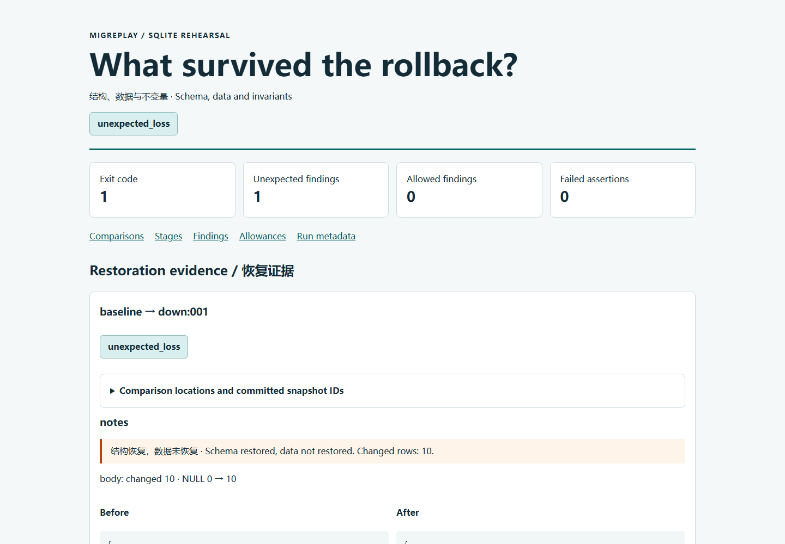

# MigReplay

Rehearse SQLite up/down migrations on synthetic data and locate data loss after schema restoration.

在合成 SQLite 数据上演练 up/down 迁移，定位结构恢复后的数据损失。

[中文说明](README_ZH.md) · [Example cases](examples/README.md) · [MIT license](LICENSE)

MigReplay executes your schema, synthetic seed, and paired migration SQL in a fresh temporary SQLite database. It compares committed states after up → down → up, checks constraints and declared invariants, and reports which SQL statements first showed each row addition or removal in JSON and offline HTML.



[Run a rehearsal](#run-a-rehearsal) · [Read the evidence](#read-the-evidence) · [Execution scope](#execution-scope-and-limits)

## Run a rehearsal

Use Python 3.12+ with SQLite 3.35+. Runtime dependencies: Python standard library. Windows with Python 3.12.14 and SQLite 3.53.1 is verified; see [compatibility.json](compatibility.json).

From the repository root:

```sh
python -m migreplay --version
python -m migreplay demo --out-dir reports/demo
python -m migreplay run --manifest examples/notes-preserved/case.json --out-dir reports/preserved
```

The demo executes both cases: `notes-loss` returns `unexpected_loss`, while `notes-preserved` returns `passed`. The combined demo exits **1** because it contains the known loss. The standalone preserved command exits **0**. Open `reports/demo/notes-loss/report.html` to see **10 body values becoming NULL even though the schema was restored**.

Each destination must be a new directory. Repeated runs need a new name. Missing parent directories are created; existing directories, input aliases, traversal components and linked/reparse paths are rejected. Defaults are `reports/run` and `reports/demo`. Each case creates `report.json` and `report.html`.

Install from the local checkout for a console command:

```sh
python -m pip install .
migreplay demo --out-dir reports/installed-demo
```

Both demo cases are bundled in the installed package. Reports use system fonts, native expandable sections, and internal anchors; they work offline with keyboard navigation and a 390px viewport.

## Describe a case

```json
{
  "format_version": 1,
  "synthetic_seed": true,
  "schema": "schema.sql",
  "seed": "seed.sql",
  "migrations": [{"id": "001", "up": "001.up.sql", "down": "001.down.sql"}],
  "keys": {"notes": ["id"]},
  "assertions": [{
    "id": "body-restored", "at": ["baseline", "down:001"],
    "sql": "SELECT COUNT(*)=10 FROM notes WHERE body IS NOT NULL", "expect": 1
  }]
}
```

SQL file paths are relative to the manifest directory. End SQL statements with semicolons. The seed must be explicitly synthetic. Assertions are single read-only queries that return one integer 0 or 1, compared with `expect`; `at` names exact stages: `baseline`, `up:<id>`, `down:<id>`, or `reup:<id>`.

Optional `allow_changes` entries declare intentional differences:

```json
{"id":"null-fill","migration":"001","phase":"down","table":"items","kind":"value_changed","columns":["value"],"reason":"Synthetic NULL intentionally replaced by the declared default."}
```

Rules match the migration, phase, table, kind and complete set of changed columns exactly. Supported kinds are `column_missing`, `value_changed`, `rows_added`, `rows_removed`, and `table_missing`; the last three use an empty `columns` array. Rules cannot excuse failed assertions, constraints, execution errors, or changed keys. Unused rules remain visible.

## Read the evidence

| Exit | Status | Meaning |
| --- | --- | --- |
| 0 | `passed` | All completed restoration/replay comparisons and assertions pass |
| 0 | `expected_irreversible` | Every restoration difference is precisely allowed; the allowed finding count is printed |
| 1 | `unexpected_loss` | Unallowed restoration difference or failed assertion |
| 2 | `invalid_input` | Manifest, source, or output request rejected |
| 3 | `incomplete` | Execution, constraint check, budget, cancellation, cleanup, or output failure |

Priority is 3 > 2 > 1 > 0. CLI, JSON and HTML share one summary. Invalid inputs produce safe failure reports when the input boundary and new output destination are valid. An invalid output destination creates no files. Exhausted budgets or output failures remove owned partial output and leave a safe CLI terminal.

`schema_version=1` includes runtime and input hashes, limits, stages, comparisons, assertions, findings, allowance usage, diagnostics and summary. It preserves unknown `null` separately from known `0`. Expand stages for provisional/committed/rolled-back snapshots, `final_snapshot_id`, checks and assertion instances. Comparisons use committed final snapshots: each down result against its original predecessor, each reup result against its first up result. First observed changes and first failed restoration locations have separate fields.

Reliable primary or declared keys support added/removed-key and changed-row counts. Without reliable keys, full rows form a multiset that preserves duplicates; per-row change attribution is unknown. Typed canonical values distinguish NULL, text, integer, real and blob. SHA-256 summaries cover schema, keys, full rows, columns and AUTOINCREMENT sequence state; exact canonical values drive equality. Reports export summaries, counts, names and source locations. Keep names and allowance reasons suitable for sharing: they appear in reports, while raw SQL, row/key values, assertion values and absolute input paths stay private.

In **Findings and diagnostics**, the `source` of a `rows_added`, `rows_removed`, or `keys_changed` finding gives the file, statement number and line range. It locates the first comparable statement snapshot showing at least one of the final added or removed keys. For `keys_changed`, both directions must be visible together. With no reliable key, additions and removals track changes in the number of copies of each distinct full row. A missing table or incompatible row identity provides no location.

## Execution scope and limits

Each report describes the supplied synthetic data and declared invariants. Rehearse additional synthetic datasets to explore other restoration behavior. Schema+seed initialization and each migration direction run as separate transactions. A failure stops later stages; rolled-back observations are discarded candidates. Foreign-key and integrity checks run before commit, assertions after commit. SQLite's immediate/deferred constraint behavior is retained. Schema text comparison conservatively preserves meaningful tokens.

Execution accepts explicit SQL files and a manifest, always in a new temporary database. User transactions, PRAGMA, ATTACH/DETACH, VACUUM, virtual/TEMP tables, extensions and external functions are denied. One shared 30-second deadline spans execution, analysis and output; a supervisor owns and can terminate both coordinator and SQL worker.

| Resource | Limit |
| --- | --- |
| Manifest; SQL file / combined SQL | 256 KiB; 1 MiB / 4 MiB |
| Migration pairs; statements per file / executed | 20; 200 / 1,000 |
| Tables; columns per table | 50; 100 |
| Rows per table / database; value | 10,000 / 50,000; 1 MiB |
| Snapshot / cumulative snapshots | 16 MiB / 64 MiB |
| IPC frames total; temporary database | 64 MiB; 64 MiB |
| JSON / HTML, actual UTF-8 bytes | 16 MiB / 24 MiB |
| Statement / whole run | 2 seconds / 30 seconds |
| Progress interval; trigger depth; attached databases | 1,000 instructions; 10; 0 |

The limits bound database work and output. Temporary files use the current user's filesystem permissions. Input files remain read-only.

## Test and contribute

```sh
python -m unittest discover -s tests -v
python -m compileall -q migreplay
```

Add a self-contained synthetic directory under `examples/` with schema, seed, up/down SQL, `case.json`, and independently handwritten `expected.json`. Include the failing and repaired variants, exact expected counts, source positions and invariants. The shipped cases cover lost note bodies, NULL/default replacement, foreign-key table rebuilds and backup restoration. See [examples/README.md](examples/README.md).

MIT © 2026 cloudwallker.
