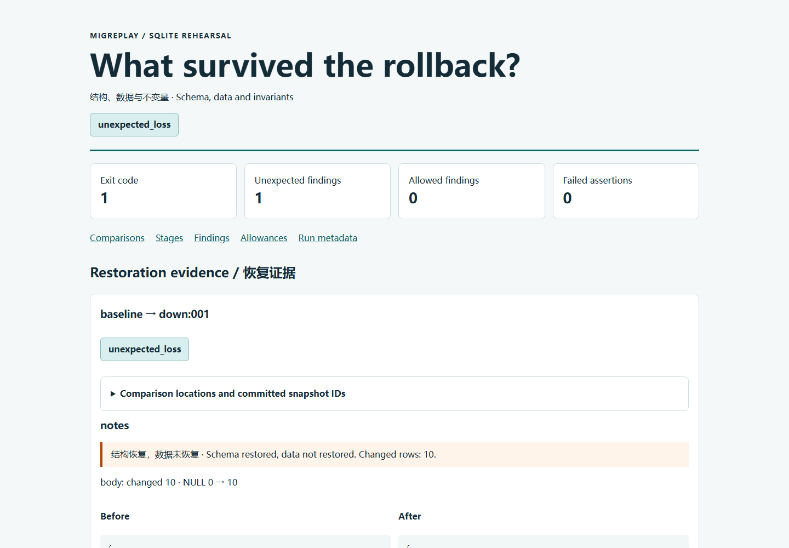

# MigReplay

在合成 SQLite 数据上演练 up/down 迁移，定位结构恢复后的数据损失。

Rehearse SQLite up/down migrations on synthetic data and locate data loss after schema restoration.

[English](README.md) · [示例说明](examples/README.md) · [MIT 许可证](LICENSE)

MigReplay 在新建临时 SQLite 数据库中执行 schema、合成 seed 和成对迁移 SQL，对比 up → down → up 后的已提交状态，检查约束及声明的不变量，并在 JSON 与离线 HTML 报告中定位首次观察到行增减的 SQL 语句。



[运行](#运行) · [看懂报告](#看懂报告) · [执行范围与限额](#执行范围与限额)

## 运行

需要 Python 3.12+、SQLite 3.35+，运行依赖为 Python 标准库。已验证 Windows、Python 3.12.14、SQLite 3.53.1；版本记录见 [compatibility.json](compatibility.json)。

在仓库根目录执行：

```sh
python -m migreplay --version
python -m migreplay demo --out-dir reports/demo
python -m migreplay run --manifest examples/notes-preserved/case.json --out-dir reports/preserved
```

demo 执行损失与修复两个案例：`notes-loss` 为 `unexpected_loss`，`notes-preserved` 为 `passed`。因为包含已知损失，demo 退出码为 **1**；单独运行修复案例退出 **0**。打开 `reports/demo/notes-loss/report.html`，可见**结构恢复，但 10 条 body 变为 NULL**。

输出目的地必须是新目录；重复运行请更换目录名。缺失的父目录会建立，已有目录、输入别名、路径越界组件和链接/reparse 路径会拒绝。默认目录是 `reports/run`、`reports/demo`。每个案例生成 `report.json` 和 `report.html`。

也可从本地源码安装命令行入口：

```sh
python -m pip install .
migreplay demo --out-dir reports/installed-demo
```

安装包包含两个演示案例。HTML 使用系统字体、原生折叠区和内部锚点，支持离线、键盘导航和 390px 视口。

## 输入清单

```json
{
  "format_version": 1,
  "synthetic_seed": true,
  "schema": "schema.sql",
  "seed": "seed.sql",
  "migrations": [{"id": "001", "up": "001.up.sql", "down": "001.down.sql"}],
  "keys": {"notes": ["id"]},
  "assertions": [{
    "id": "body-restored", "at": ["baseline", "down:001"],
    "sql": "SELECT COUNT(*)=10 FROM notes WHERE body IS NOT NULL", "expect": 1
  }]
}
```

SQL 文件路径相对于清单目录，语句以分号结束，seed 必须明确声明为合成数据。断言是单条只读查询，返回一个整数 0 或 1，与 `expect` 对照。`at` 使用准确阶段名：`baseline`、`up:<id>`、`down:<id>`、`reup:<id>`。

可用 `allow_changes` 数组声明预期不可逆变化：

```json
{"id":"null-fill","migration":"001","phase":"down","table":"items","kind":"value_changed","columns":["value"],"reason":"Synthetic NULL intentionally replaced by the declared default."}
```

规则精确匹配迁移、方向、表、变化类型及完整实际变化列集合。支持 `column_missing`、`value_changed`、`rows_added`、`rows_removed`、`table_missing`；后三类的 `columns` 为空数组。规则不能豁免断言、约束、执行错误或主键变化。未使用规则也会显示。

## 看懂报告

| 退出码 | 状态 | 含义 |
| --- | --- | --- |
| 0 | `passed` | 完成的恢复/重跑比较及断言全部通过 |
| 0 | `expected_irreversible` | 恢复差异全部精确获准，同时打印允许 finding 数 |
| 1 | `unexpected_loss` | 有未获准恢复差异或失败断言 |
| 2 | `invalid_input` | 清单、来源或输出申请被拒绝 |
| 3 | `incomplete` | 执行、约束检查、预算、取消、清理或输出失败 |

优先级为 3 > 2 > 1 > 0。CLI、JSON、HTML 共用同一摘要。输入无效且边界、新输出目录合法时，仍生成受控失败报告。非法输出不创建文件；预算耗尽或输出失败会清理本次拥有的部分文件，并保留安全 CLI 终态。

`schema_version=1` 包含运行版本、输入哈希、限额、阶段、比较、断言、发现、规则使用、诊断与摘要。未知值用 `null`，已知零用 `0`。展开阶段可见 provisional/committed/rolled_back 快照、`final_snapshot_id`、检查及断言。比较只使用最终已提交快照：down 对照原迁移前状态，reup 对照首次 up 状态。首次观察变化与首次确认恢复失败分别定位。

可靠主键或声明键支持增删键与变更行计数；无可靠键时以完整行多重集合保留重复次数，逐行归因显示未知。带类型的规范编码区分 NULL、文本、整数、浮点及 blob。结构、键、全行、列和自增序列使用 SHA-256 摘要，是否相等则依据准确规范值。报告展示摘要、计数、名称与相对来源位置；名称及规则 reason 会公开显示，应适合分享。原始 SQL、行/键值、断言值和输入绝对路径保留在内部。

在报告的 **Findings and diagnostics** 中查看 `rows_added`、`rows_removed` 或 `keys_changed` 的 `source`，可找到文件、语句序号和行号范围。它指向首个能观察到至少一个最终新增或移除键的可比快照。`keys_changed` 要求同一快照同时出现键的新增和移除。无可靠键时按每种完整行的出现次数判断增减。中途表不存在或行身份不可比较的快照不提供位置。

## 执行范围与限额

报告描述本次合成数据和声明的不变量；可增加合成数据集，演练更多恢复情形。schema+seed 初始化及每个迁移方向各自一个事务；失败后停止后续阶段，rolled_back 观察为废弃候选。外键及完整性检查在提交前执行，断言在提交后执行，保留 SQLite 原有 immediate/deferred 约束语义。结构文本对照保守保留有意义的 token。

输入为显式 SQL 文件与清单，始终使用新临时数据库。用户事务、PRAGMA、ATTACH/DETACH、VACUUM、虚拟/TEMP 表、扩展与外部函数被拒绝。SQL、分析和输出共享一个 30 秒截止时间；监督进程持有并可终止协调进程及 SQL worker。

| 资源 | 上限 |
| --- | --- |
| 清单；单 SQL / 合计 SQL | 256 KiB；1 MiB / 4 MiB |
| 迁移对；每文件 / 总执行语句 | 20；200 / 1,000 |
| 表；每表列 | 50；100 |
| 每表 / 全库行；单值 | 10,000 / 50,000；1 MiB |
| 单快照 / 累计快照 | 16 MiB / 64 MiB |
| IPC 总帧；临时数据库 | 64 MiB；64 MiB |
| JSON / HTML 实际 UTF-8 字节 | 16 MiB / 24 MiB |
| 单语句 / 全过程 | 2 秒 / 30 秒 |
| progress 间隔；触发器深度；附加数据库 | 1,000 指令；10；0 |

限额约束数据库工作及输出。临时目录使用当前用户的文件系统权限，输入文件只读。

## 测试与贡献

```sh
python -m unittest discover -s tests -v
python -m compileall -q migreplay
```

在 `examples/` 添加独立合成目录，包含 schema、seed、up/down SQL、`case.json` 和独立手写的 `expected.json`。请提供失败及修复变体、准确计数、来源位置和不变量。内置示例包括正文丢失、NULL/default 替换、外键表重建与备份恢复，见[示例说明](examples/README.md)。

MIT © 2026 cloudwallker。
